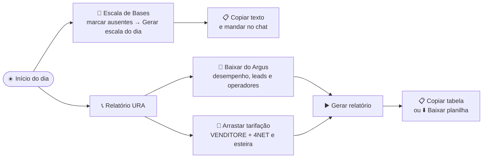
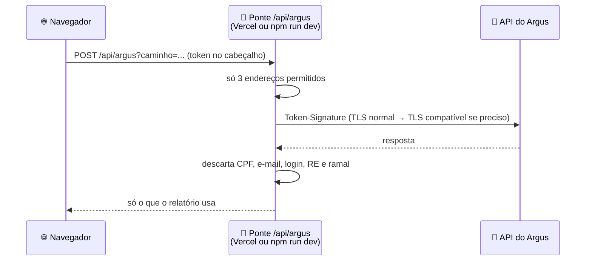

<div align="center">

# ⚡ BenHermes

### Hub de automações e relatórios da operação

Escala de bases, relatório de produtividade da URA, formatador de planilhas e relatórios de atividades,<br>
tudo no navegador, sem instalar nada.

[](https://github.com/ProfetaSaru/BENHERMES/actions/workflows/ci.yml)


[](https://benhermes.vercel.app)

**[🌐 Abrir o BenHermes](https://benhermes.vercel.app)**

</div>

> [!IMPORTANT]
> **O BenHermes é o sistema principal da operação.** A escala de bases e o relatório da URA, que antes rodavam no
> **BENZAITEN** (Python), agora vivem aqui. O BENZAITEN fica **congelado como reserva**: não recebe mudanças novas.
> Veja [BenHermes × BENZAITEN](#-benhermes--benzaiten).

---

## 📑 Sumário

| | |
|---|---|
| 🧭 [Ferramentas](#-ferramentas) | 🔒 [Onde ficam os dados](#-onde-ficam-os-dados) |
| ☀️ [Rotina diária](#️-rotina-diária) | 🧪 [Testes e checagem automática](#-testes-e-checagem-automática) |
| 🎲 [Escala de Bases](#-escala-de-bases-ativo-2) | 🚀 [Como executar localmente](#-como-executar-localmente) |
| 📞 [Relatório URA](#-relatório-de-produtividade-ura) | 🏗️ [Arquitetura](#️-arquitetura) |
| 🔌 [API do Argus](#-api-do-argus) | 🐉 [BenHermes × BENZAITEN](#-benhermes--benzaiten) |
| 💬 [WhatsApp das Baias](#-whatsapp-das-baias) | 🛠️ [Tecnologias](#️-tecnologias) |
| ⚙️ [Configurações (feriados)](#️-configurações-do-hub) | |
| 📋 [Central de Relatórios](#-central-de-relatórios) | 📊 [Formatador de Planilhas](#-formatador-de-planilhas) |

---

## 🧭 Ferramentas

| | Ferramenta | Para que serve | Quando usar |
|:-:|---|---|---|
| 🎲 | **Escala de Bases** | Rodízio diário das bases do INSS entre os grupos dos supervisores do Ativo 2 | Todo dia útil, de manhã |
| 📞 | **Relatório URA** | TMA, TMO, leads, custo, vendas e clientes por operador e equipe, com setas e cores | Todo dia útil (relatório do dia anterior) |
| 💬 | **WhatsApp das Baias** | Mapa das mesas com a situação do WhatsApp de cada baia (OK, banido, restringido, não tem) e a planilha de resumo | Ao longo do dia, sempre que um número cair ou voltar |
| 📊 | **Formatador de Planilhas** | Converte qualquer planilha no CSV de mailing `CPF;BENEFICIO;NOME;TELEFONE1..5` | Quando chega uma base nova |
| 📋 | **Central de Relatórios** | Relatórios de atividades e formulários a partir de modelos Markdown | No fim do expediente |
| 🗂️ | **Histórico & Arquivos** | Relatórios de atividades salvos, com restauração completa | Quando precisar rever um dia |
| ⚙️ | **Configurações do Hub** | Feriados locais (Carnaval, municipais...) que valem para todas as ferramentas | Uma vez por ano, ou quando surgir feriado |

---

## ☀️ Rotina diária



- [ ] **Escala:** abrir **Escala de Bases**, clicar nos nomes de quem faltou e em **Gerar escala do dia**. Depois, **Copiar texto** para o chat.
- [ ] **Relatório:** abrir **Relatório URA** (a data já vem como o dia útil anterior), clicar em **Baixar do Argus**, arrastar a tarifação e a esteira, digitar o **valor real da fatura** de cada tarifação (se já tiver) e clicar em **Gerar relatório**.
- [ ] **Entregar:** **Copiar tabela** (cola com as cores no Excel e no Outlook) ou **Baixar planilha**.

> [!TIP]
> Os arquivos são reconhecidos **pelas colunas**: o nome do arquivo não importa, e dá para arrastar todos de uma vez.

---

## 🎲 Escala de Bases (Ativo 2)

A escala é um **rodízio**: a cada dia, cada pessoa anda **uma base para frente** e volta para a primeira depois da
última. Assim **ninguém repete uma base antes de passar por todas**.

```
              NOTA 0     NOTA 1     NOTA 2     NOTA 3
  21/10       ANA        BRUNO      CARLA      DIEGO
  22/10       DIEGO      ANA        BRUNO      CARLA      ← cada um andou uma base
  23/10       CARLA      DIEGO      ANA        BRUNO
```

<details>
<summary><b>📐 Regras completas do rodízio</b></summary>

| Regra | Como funciona |
|---|---|
| 🔁 Ponto de partida | O último dia **completo** do histórico (todas as bases preenchidas, ninguém repetido). Sem histórico, começa pela ordem do cadastro |
| 📅 Dias | Conta escalas, não dias do calendário: de sexta para segunda é um passo só |
| 🚫 Ausentes | A base de quem faltou vai para quem está com **menos bases** (de preferência quem não teve essa base no dia anterior). Quando a pessoa volta, ela **retoma a posição dela**, como se não tivesse faltado |
| ➖ Menos pessoas que bases | Algumas pessoas ficam com uma base a mais (nunca duas a mais) |
| ➕ Mais pessoas que bases | Quem fica sem base também entra no rodízio: cada dia é a vez de um |
| 🆕 Pessoa nova | Entra no fim da roda |
| 🔄 Refazer o dia | Dá o mesmo resultado (o rodízio não é aleatório), a não ser que os ausentes mudem |
| 🎉 Feriados | Aviso de fim de semana, feriado nacional e feriado local cadastrado em [Configurações](#️-configurações-do-hub) |

</details>

<details>
<summary><b>📥 Importar e exportar</b></summary>

- **Importar:** a planilha antiga `Escala_Bases_Ativo2.xlsm` (cadastro + histórico), o `bases.xlsx` ou o `historico_escalas.csv` do BENZAITEN. Dias que já existem não são sobrescritos.
- **Exportar histórico:** CSV `Data;Base;Responsavel`, o mesmo formato do BENZAITEN. **Faça de vez em quando, como backup.**
- **Baixar planilha:** `.xlsx` colorido com a escala do dia e os últimos 10 dias.

</details>

---

## 📞 Relatório de Produtividade URA

| Coluna | De onde vem |
|---|---|
| **TMA / TMO** | Argus › Desempenho (TMA e TME), média ponderada pelos atendimentos de cada sessão |
| **Leads atendidos/URA** | Argus › Desempenho do dia: atendimentos de cada operador, sem os robôs |
| **Custo total** | Tarifação VENDITORE + 4NET: custo do operador + **rateio do custo dos robôs da URA** pelos leads. Com o valor real da fatura, corrigido na mesma proporção |
| **Vendas geral** | Esteira Vanguard: soma do Valor Contrato nas etapas Andamento, Pendente e Pago |
| **Clientes efetivados** | Esteira Vanguard: CPFs únicos nas etapas Andamento e Pago |
| **Custo por CPF / Produção por lead** | Custo ÷ clientes / vendas ÷ leads |

Ordem: quem mais vendeu primeiro (empate: mais leads), depois o total de cada equipe (a equipe é o primeiro nome do
supervisor), o total dos operadores, as ligações sem derivação e o total geral.

<details>
<summary><b>🎨 Setas e cores (o que muda sozinho)</b></summary>

| | Com o histórico/metas | Sem nada configurado |
|---|---|---|
| **▲▼ Setas** | Comparação com o relatório do dia útil anterior salvo no histórico | A comparação é **montada sozinha**: leads do dia anterior pela API do Argus e vendas pela esteira. O custo fica sem comparação, e a coluna some |
| **🟩🟨🟥 Cores** | Metas preenchidas em Configurações do relatório (verde atingiu, vermelho abaixo do limite) | **Automáticas por terços**: o melhor terço do dia fica verde, o do meio amarelo e o pior vermelho |

Setas: **verde é bom** (mais leads e vendas, menos custo); vermelho é ruim. TMA, TMO e custo por CPF zerados ficam sem cor.

</details>

<details>
<summary><b>🧾 Conferência, apelidos e metas</b></summary>

- **Valor real das tarifações:** o Argus costuma só estimar o custo. Em **Gerar relatório**, digite o total da fatura da VENDITORE e da 4NET (a operadora é reconhecida pelo nome do arquivo). Cada linha daquela tarifação (operadores, robôs, sem derivação) é multiplicada por *real ÷ estimado*: o total bate com a fatura e a divisão entre os operadores continua a mesma. Em branco, vale o valor do Argus. A conferência e a planilha mostram o valor estimado e o usado.
- **Conferência:** de onde veio cada número, arquivos ignorados (de outro dia), custos que batem com a tarifação, nomes sem vínculo e ex-colaboradores.
- **Apelidos:** quando um nome aparece diferente em algum sistema (ex.: `KARLA CRUZ` × `CARLA CRUZ`), escolha "É a mesma pessoa que..." na conferência e o relatório é gerado de novo.
- **Metas:** em Configurações do relatório, por indicador, com sentido (maior/menor é melhor) e limites verde e vermelho.
- **Histórico:** guarda só os totais de cada dia. Pode importar o `relatorio_ura.csv`, o `operadores.xlsx` e o `metas.xlsx` do BENZAITEN.
- **Exportações manuais têm prioridade:** se você arrastar uma exportação do Argus do mesmo tipo de um download da API (ex.: leads), ela **substitui** a da API, em vez de somar.

</details>

---

## 🔌 API do Argus

O botão **Baixar do Argus** traz o desempenho (TMA/TME), os leads e o cadastro de operadores do dia. A **tarifação
continua manual**, porque não existe na API.



<details>
<summary><b>🛡️ Regras da ponte e diagnóstico</b></summary>

- O navegador não consegue chamar o Argus direto (CORS e TLS antigo). A ponte, [`server/argusProxy.ts`](server/argusProxy.ts), roda no servidor do Vite (`npm run dev`/`preview`) e na função da Vercel [`api/argus.ts`](api/argus.ts).
- Se o servidor do Argus recusar a conexão normal, ela tenta o **modo compatível** (TLS antigo), com o **certificado sempre verificado**.
- Repassa só `report/desempenhoresumido`, `cmd/listargrupos` e `cmd/listarusuarios`, e **não grava nem registra nada**.
- **Leads:** desempenho geral do dia, sem os robôs (`OPER VIRTUAL`). O filtro pelo grupo RECEPTIVO - URA trazia só quem **está** no grupo (346 de 2.985 leads em 20/10/2026).
- **Diagnóstico dos leads** (Configurações do relatório): CSV com os leads de cada operador por filtro, sessões e datas. Serve para comparar com a exportação manual. Sem dados de clientes.

</details>

---

## 💬 WhatsApp das Baias

Substitui a planilha **RELATORIO-WHATSAPP-INTUITIVO**. Cada sala (Comercial 1, Comercial 2) tem suas mesas no mesmo
desenho do mapa do **Sistema de Chamados**: supervisor e backup no topo, baias do lado esquerdo (`OP1-E1`…) e do
direito (`OP1-D1`…), com o corredor no meio.

1. **Primeira vez:** **Importar planilha** → escolha a planilha atual → confira a prévia → **Substituir mapa**.
2. **No dia a dia:** clique numa baia para trocar o **operador** e a **situação**; clique no nome da equipe para trocar o
   **supervisor**. Tudo salva na hora, neste navegador.
3. **Para enviar:** **Baixar planilha** gera o `.xlsx` no visual da planilha antiga, com data e hora no título.

| Situação | Na tela | Na planilha |
|---|---|---|
| ✅ OK | bolinha verde | `OK` em verde |
| ⛔ BANIDO | baia vermelha | `BANIDO` em vermelho |
| ⏳ RESTRINGIDO | baia amarela, "até 29/10 14:00 · faltam 1d 3h" | `RESTRINGIDO ATÉ 29/10 14:00` em amarelo-escuro |
| ⚪ NÃO TEM | baia cinza | `NÃO TEM` em cinza |

<details>
<summary><b>⏳ Restrição, filtros e celulares corporativos</b></summary>

- **Restringido** pede **por quanto tempo** (horas ou dias). Quando o prazo acaba, a baia **não volta sozinha** para
  OK: aparece "Restrição terminou — confira" e o botão **Voltar para OK**.
- **Filtros:** *Só problemas* (banido, restringido, não tem) e *Vagas vazias* apagam as outras baias no mapa.
- **A situação é da baia** (do número daquele lugar): esvaziar a baia não muda a situação.
- **Celulares corporativos:** um cartão por cor, com o WhatsApp **Messenger** e o **Business**.

</details>

<details>
<summary><b>🧩 Salas, mesas e arquivos</b></summary>

- **Configurar salas e mesas** (no fim da página): nova sala, nova mesa (nome, sigla, supervisor, baias de cada lado,
  quem fica no centro, onde começa a baia 1), desativar uma baia clicando na prévia. Diminuir uma mesa com operador
  pede confirmação.
- **Importar planilha** reconhece salas ("STATUS DOS WHATSAPP DO COMERCIAL 1"), equipes ("1º EQUIPE - Supervisor",
  ou qualquer título acima da linha `OPERADOR | WHATSAPP`), `VAZIO`, `SUPERVISOR`/`BACKUP` e os celulares. Situação
  desconhecida vira NÃO TEM, com aviso na prévia. "Digital" vira a mesa `DG`.
- **Exportar mapa / Importar mapa** (`.json`): cópia de segurança e o formato que vai levar o mapa para o Sistema de
  Chamados, onde os supervisores poderão atualizar a própria equipe.

</details>

---

## ⚙️ Configurações do Hub

**Feriados locais** (Carnaval, Corpus Christi, feriados municipais): cadastre à mão ou importe o `feriados.xlsx` do
BENZAITEN. Eles são pulados no **dia útil anterior** do Relatório URA (data e comparação) e aparecem como aviso na
Escala. Os **feriados nacionais**, inclusive a Sexta-feira Santa, já são calculados sozinhos.

---

## 📋 Central de Relatórios

Relatórios de atividades com registro de tarefas (horário, título e descrição), ordenação cronológica, cópia com um
clique e histórico com restauração completa. Os modelos são arquivos **Markdown com Frontmatter YAML**.

<details>
<summary><b>✨ Funcionalidades</b></summary>

- **⏱️ Registro de tarefas** com horário inicial, final, título e descrição opcional.
- **🔠 Títulos em maiúsculo**, automaticamente.
- **📅 Ordenação cronológica** pelo horário de início.
- **🛡️ Validação de horários** (hora final antes da inicial é bloqueada).
- **✏️ Edição e exclusão**, com **🗑️ limpeza em lote** (modal com `ESC`).
- **📋 Relatório com 1 clique** para a área de transferência.
- **💾 Histórico universal**: qualquer relatório salvo é restaurado com todos os campos e o modelo ativo.
- **⚡ Rascunhos em tempo real**: cada modelo lembra o que foi preenchido, mesmo após recarregar a página.

</details>

<details>
<summary><b>📑 Como criar novos modelos de relatório (expansíveis e não expansíveis)</b></summary>


A aplicação utiliza um motor dinâmico baseado em arquivos **Markdown (.md)** com metadados **YAML Frontmatter** no topo. Existem dois tipos de relatórios:

| Tipo | `expandable` | Comportamento | Casos de Uso Típicos |
| :--- | :---: | :--- | :--- |
| **Expansível** | `true` | Integra o painel de cadastro de tarefas diárias com horários e suporte a variáveis extras de cabeçalho. | Relatório Diário Clássico, Grade de Produtividade em Tabela. |
| **Não Expansível** | `false` | Funciona como formulário dinâmico puro. Transforma variáveis do markdown em inputs e textareas automáticos. | Pós-Mortem / Incidentes, Onboarding de Novo Colaborador, Passagem de Plantão, Comunicados. |

---

#### 1. Anatomia e Sintaxe de um Arquivo de Modelo (.md)

Todo modelo possui um bloco **Frontmatter** no topo (entre `---`) seguido pelo corpo do documento em Markdown:

```markdown
---
title: Nome Exibido no Catálogo
description: Descrição curta do objetivo do relatório
category: atividades # categorias: atividades | incidentes | rh | suporte | comunicados | geral
icon: FileText       # ícone Lucide: FileText, TableProperties, AlertTriangle, UserCheck, Radio, etc.
expandable: true     # true para expansível (com tarefas) ou false para não expansível (formulário)
---

# 📋 TÍTULO DO RELATÓRIO
**Data:** {{data_atual}}
**Responsável:** {{nome_colaborador}}

---

{{conteudo_ou_tarefas}}
```

#### 🏷️ Variáveis Dinâmicas e Tags Especiais

- **Campos de Texto Simples:** `{{nome_campo}}` cria um input de texto comum.
- **Campos Multilinha (Textarea):** Adicione o sufixo `:textarea` (ex: `{{observacoes:textarea}}`) ou utilize nomes como `descricao`, `motivo`, `detalhes`, `pendencias`, `acoes`.
- **Campos de Senha:** Use o sufixo `:password` (ex: `{{senha_temporaria:password}}`) para gerar um campo com botão de mostrar/ocultar senha.
- **Variáveis Automáticas do Sistema:** `{{data_atual}}` e `{{hora_atual}}` são preenchidas automaticamente com a data e hora do momento.
- **Tags de Tarefas e Produtividade (Exclusivo para `expandable: true`):**
  - `{{tarefas}}`: Insere as tarefas cadastradas no formato de lista clássica com horários.
  - `{{tarefas_tabela}}` ou `{{tabela_tarefas}}`: Formata as tarefas cadastradas diretamente em uma tabela Markdown organizada.
  - `{{bloco_produtividade}}`: Gera o bloco operacional completo organizado por seções (Desbloqueados, Formalização, Anuência, Tentativas de contato), separadores padronizados, contagem de itens e TMA calculado.
  - `{{tma}}` / `{{tma_medio}}`: Tempo Médio de Atendimento calculado automaticamente a partir dos horários inicial e final (ex: `22 min`).
  - `{{total_geral_finalizado}}`: Total de atendimentos concluídos com hora inicial e final.
  - `{{total_desbloqueados}}`, `{{total_formalizados}}`, `{{total_anuencia}}`: Contadores específicos por etapa.
  - `{{tentativas_contato}}`: Lista de contatos no formato `CPF HORA`.

- **Categorias e Rótulos Customizados no Frontmatter:**
  - `categories`: Lista de etapas/categorias que geram botões de seleção rápida (pills) no formulário (ex.: `[Desbloqueados, Formalização, Anuência, Tentativas de contato]`). Para tentativas de contato, a hora final torna-se opcional automaticamente.
  - `itemLabel`: Rótulo dinâmico do formulário (ex.: `CPF do Cliente`), alterando o título e os botões da interface.

---

#### 2. Exemplo: Criando um Relatório EXPANSÍVEL

Um relatório expansível permite que o usuário adicione quantas atividades quiser ao longo do dia, podendo também solicitar campos extras (como número da sprint, squad ou colaborador):

Crie o arquivo em `src/templates/reports/atividades-sprint.md`:

```markdown
---
title: Fechamento de Sprint Diária
description: Registro de atividades integrado com metas e identificação da sprint
category: atividades
icon: TableProperties
expandable: true
---

# 🏃‍♂️ RELATÓRIO DIÁRIO DE SPRINT

**Sprint:** {{numero_sprint}}
**Squad / Projeto:** {{nome_squad}}
**Data:** {{data_atual}} às {{hora_atual}}

---

### 🎯 Metas e Entregas do Dia
{{metas_atingidas:textarea}}

---

### 📋 Atividades Realizadas
{{tarefas_tabela}}

---

### 🚧 Bloqueios e Impedimentos
{{impedimentos:textarea}}
```

---

#### 2.1 Exemplo: Relatório de Produtividade com Categorias por CPF e TMA

Para relatórios operacionais divididos em etapas (ex.: Desbloqueados, Formalização, Anuência e Tentativas de contato) com cálculo de Tempo Médio de Atendimento:

Crie o arquivo em `src/templates/reports/produtividade-atendimento.md`:

```markdown
---
title: Relatório de Produtividade & TMA
description: Apontamento operacional por CPF com cálculo automático de totais por etapa e TMA
category: operacional
icon: Activity
expandable: true
categories:
  - Desbloqueados
  - Formalização
  - Anuência
  - Tentativas de contato
itemLabel: CPF do Cliente
---

RELATÓRIO DE PRODUTIVIDADE - {{nome_colaborador}}
========================================
{{bloco_produtividade}}
```

---

#### 3. Exemplo: Criando um Relatório NÃO EXPANSÍVEL

Um relatório não expansível gera uma interface de formulário direto, ideal para checklists, registros pontuais, comunicados ou incidentes:

Crie o arquivo em `src/templates/reports/checklist-deploy.md`:

```markdown
---
title: Checklist de Deploy em Produção
description: Registro e validação de liberação de versão em ambiente produtivo
category: suporte
icon: Radio
expandable: false
---

# 🚀 RELATÓRIO DE DEPLOY EM PRODUÇÃO

**Versão / Tag:** {{versao_sistema}}
**Ambiente:** {{ambiente}}
**Horário de Início:** {{hora_inicio}}
**Horário de Término:** {{hora_termino}}
**Responsável pelo Deploy:** {{responsavel}}

---

## 🔍 Validações Realizadas
- [x] Backup de banco de dados executado
- [x] Migrations aplicadas sem erros
- [x] Testes de fumaça (Smoke Tests) validados

### 📝 Observações e Rollback Plan
{{observacoes_rollback:textarea}}
```

---

#### 4. Como Registrar Novos Modelos no Código-Fonte

Após criar seu arquivo `.md` na pasta `src/templates/reports/`:

1. Abra o arquivo [`src/templates/reports/index.ts`](src/templates/reports/index.ts).
2. Importe o arquivo utilizando a diretiva `?raw` do Vite:
   ```ts
   import checklistDeployRaw from './checklist-deploy.md?raw';
   ```
3. Adicione o modelo ao array `BUILTIN_TEMPLATES`:
   ```ts
   export const BUILTIN_TEMPLATES: MarkdownTemplateMeta[] = [
     // Modelos existentes...
     { ...parseMarkdownTemplate(checklistDeployRaw, 'checklist-deploy').meta, isBuiltin: true },
   ];
   ```

Pronto! Ao salvar, o novo modelo aparecerá automaticamente no catálogo **"Mudar Modelo"**, já com suporte a salvamento no histórico, filtros e restauração completos.

---

#### 5. Como Adicionar pela Própria Interface Web (Sem Alterar Código)

Você também pode adicionar modelos diretamente pelo navegador:

1. No Gerador, clique no botão **"Mudar Modelo"**.
2. Escolha uma das opções disponíveis:
   - **"Novo Modelo"**: Abre um editor integrado com syntax highlighting e validação em tempo real. Digite seu frontmatter e corpo markdown e clique em salvar.
   - **"Importar .md"**: Selecione qualquer arquivo `.md` do seu computador.
   - **"Gerar Prompt para IA"**: Copia um prompt estruturado para que o ChatGPT, Claude ou Gemini gere o modelo Markdown exato pronto para você colar no sistema.

</details>

<details>
<summary><b>📄 Exemplo do relatório gerado</b></summary>


```text
RELATÓRIO DE CONCLUSÃO DE ATIVIDADES
08:00 – 09:00 *ALINHAMENTO DIÁRIO:* - Daily meeting com o time;
09:00 – 12:00 *REFATORAÇÃO DE CÓDIGO:* - Migração para React e TypeScript;
13:30 – 15:00 *CODE REVIEW*;
```

</details>

---

## 📊 Formatador de Planilhas

Converte `.xlsx`, `.xls`, `.csv`, `.tsv` e `.txt` no CSV de mailing `CPF;BENEFICIO;NOME;TELEFONE1..5`:
acha o cabeçalho nas 10 primeiras linhas, identifica as colunas pelo nome (o nome exato tem preferência, sem
repetir coluna), completa o CPF que perdeu o zero à esquerda e gera UTF-8 com BOM, que abre direto no Excel.

---

## 🔒 Onde ficam os dados

> [!NOTE]
> As exportações do dia (que têm **CPFs de clientes**) ficam **só na memória da página** e somem ao fechá-la.
> O navegador guarda apenas o necessário, **no computador de quem usa**.

| Chave no navegador (`localStorage`) | O que guarda |
|---|---|
| `benhermes_escala_bases` | Cadastro de bases e pessoas, histórico e últimas escalas |
| `benhermes_relatorio_ura` | Cadastro de operadores (sem CPF/e-mail), apelidos, metas e **totais** de cada dia |
| `benhermes_argus` | Token e endereço da API do Argus |
| `benhermes_feriados` | Feriados locais |
| `benhermes_whatsapp` | Mapa do WhatsApp das Baias (salas, mesas, operadores, situações e celulares) |
| `benhermes_template_tasks` e outras | Central de Relatórios (tarefas, rascunhos e histórico) |

> [!WARNING]
> Como tudo fica no navegador, **outro computador ou outro navegador começa vazio**, e limpar os dados do navegador
> apaga o histórico. Use sempre o mesmo computador e **exporte os históricos** (escala e relatório) de vez em quando.

---

## 🧪 Testes e checagem automática

```bash
npm test          # roda todos os testes (Vitest)
npm run build     # confere os tipos (TypeScript) e gera o site
```

A cada **pull request** e a cada push na `main`, o GitHub Actions ([`ci.yml`](.github/workflows/ci.yml)) roda os
testes e o build. **PR vermelho não deve ir para a `main`.**

<details>
<summary><b>🧾 O que os testes cobrem</b></summary>

| Arquivo | O que testa |
|---|---|
| [`calendario.test.ts`](src/utils/calendario.test.ts) | Páscoa, feriados nacionais e locais, dia útil anterior |
| [`escalaBases.test.ts`](src/utils/escalaBases.test.ts) | Rodízio (ciclo completo, ausentes que retomam a posição, pessoa nova, menos pessoas), feriados, importação da `.xlsm`, CSV |
| [`uraLeitura.test.ts`](src/utils/uraLeitura.test.ts) | Valores em R$, tempos, datas, reconhecimento das exportações, CSV |
| [`uraCalculo.test.ts`](src/utils/uraCalculo.test.ts) | Relatório completo com **os mesmos números esperados do BENZAITEN**, comparação, cores automáticas e metas |
| [`argusApi.test.ts`](src/utils/argusApi.test.ts) | API simulada: leads do dia sem robôs, média ponderada, token, diagnóstico |
| [`mapaMesas.test.ts`](src/utils/mapaMesas.test.ts) | Códigos das baias (`OP1-E3`), ordem pelo supervisor ou pela porta, mudar o formato da mesa |
| [`whatsappBaias.test.ts`](src/utils/whatsappBaias.test.ts) | Situações, restrição (prazo, vencida, tempo inválido), resumo, siglas, salas e mesas, arquivo `.json` |
| [`whatsappPlanilha.test.ts`](src/utils/whatsappPlanilha.test.ts) | Leitura da planilha de WhatsApps (variações de texto, Digital, sem backup), cores da planilha gerada e ida e volta |
| [`argusProxy.test.ts`](server/argusProxy.test.ts) | A ponte descarta CPF/e-mail, só aceita os 3 endereços e exige https e token |

</details>

---

## 🚀 Como executar localmente

> **Pré-requisitos:** [Node.js](https://nodejs.org/) 18 ou superior (recomendado 22) e `npm`.

```bash
git clone https://github.com/ProfetaSaru/BENHERMES.git
cd BENHERMES
npm install
npm run dev        # http://localhost:5173/
```

| Comando | O que faz |
|---|---|
| `npm run dev` | Servidor de desenvolvimento (com a ponte do Argus) |
| `npm test` | Testes |
| `npm run build` | Confere os tipos e gera o site em `dist/` |
| `npm run preview` | Abre o site gerado (também com a ponte do Argus) |

A cada merge na `main`, a **Vercel publica sozinha** em [benhermes.vercel.app](https://benhermes.vercel.app).

---

## 🏗️ Arquitetura

<details>
<summary><b>🧱 Conceito Nevernester</b></summary>


O projeto adota o princípio **Nevernester** para manter o código limpo, legível e altamente sustentável:

1. **Componentes Atômicos Reutilizáveis (Zero Marcação Duplicada)**:
   - `Button`: Botão polimórfico com suporte a variantes (`primary`, `secondary`, `danger`, `text`, `edit`, `delete`) e ícones integrados.
   - `FormField`, `Input`, `Textarea`: Encapsulam labels, tags de campos opcionais e estilos de foco consistentes.
   - `Modal`: Diálogo modal de confirmação acessível com backdrop blur, foco e atalho `Escape`.
   - `SectionHeading` & `Panel`: Containers e cabeçalhos reutilizáveis para os blocos da aplicação.
   - `Badge` & `NotificationToast`: Indicadores visuais e alertas temporários com auto-dismiss.

2. **Lógica Desacoplada em Custom Hooks (Guard Clauses & Early Returns)**:
   - [`useTasks`](src/hooks/useTasks.ts): Responsável por operações CRUD, ordenação e persistência local.
   - [`useTaskForm`](src/hooks/useTaskForm.ts): Gestão do estado do formulário e validações com retornos antecipados.
   - [`useNotification`](src/hooks/useNotification.ts): Sistema de toasts com gerenciamento de tempo sem vazamento de memória.

</details>

<details>
<summary><b>📂 Estrutura de pastas</b></summary>

```
BENHERMES/
├── api/argus.ts                  # função da Vercel: ponte com o Argus no site
├── server/argusProxy.ts          # ponte com o Argus (mesmo código no Vite e na Vercel)
├── .github/workflows/ci.yml      # testes e build em cada PR
├── src/
│   ├── components/
│   │   ├── escala/               # Escala de Bases
│   │   ├── relatorioUra/         # Relatório URA (tabela, conferência, configurações)
│   │   ├── configuracoes/        # Configurações do Hub (feriados)
│   │   ├── formatter/            # Formatador de Planilhas
│   │   ├── reports/ templates/   # Central de Relatórios
│   │   ├── history/              # Histórico & Arquivos
│   │   ├── layout/ common/ task/ # menu, componentes comuns e tarefas
│   ├── hooks/                    # estado e localStorage (useEscalaBases, useRelatorioUra, useFeriados...)
│   ├── utils/                    # regras, sem tela (e os *.test.ts ao lado)
│   │   ├── calendario.ts         # datas, feriados, dia útil anterior
│   │   ├── escalaBases.ts        # rodízio, importação e planilha da escala
│   │   ├── uraLeitura.ts         # leitura das exportações (CSV/Excel, R$, tempos)
│   │   ├── uraCalculo.ts         # contas do relatório, comparação, metas e cores
│   │   ├── uraExportacao.ts      # planilha, tabela colorida e CSV do histórico
│   │   ├── argusApi.ts           # download e diagnóstico pela API do Argus
│   │   └── planilhaColorida.ts   # .xlsx com cores (exceljs, sob demanda)
│   ├── templates/reports/        # modelos Markdown da Central de Relatórios
│   ├── styles/                   # CSS modular
│   └── App.tsx · main.tsx
├── legacy_backup/                # versão original em HTML/JS
└── vite.config.ts · package.json · tsconfig.json
```

</details>

---

## 🐉 BenHermes × BENZAITEN

O **[BENZAITEN](https://github.com/nanzinx/Benzaiten)** é a versão em Python (terminal) das mesmas automações. As regras
do BenHermes foram portadas dele e conferidas número a número (285 células do relatório sem nenhuma diferença,
500 cenários de rodízio iguais).

| | BenHermes | BENZAITEN |
|---|---|---|
| Situação | ✅ **Sistema principal** | 🧊 **Reserva, congelado** |
| Onde roda | Navegador ([benhermes.vercel.app](https://benhermes.vercel.app)) | Terminal (Python), no computador |
| Mudanças novas | Entram aqui | Não entram mais |
| Quando usar | Sempre | Só se o BenHermes ficar fora do ar |

Os históricos são **intercambiáveis**: `historico_escalas.csv` e `relatorio_ura.csv` exportados por um são importados
pelo outro.

---

## 🛠️ Tecnologias

[React 18](https://react.dev/) · [TypeScript](https://www.typescriptlang.org/) · [Vite](https://vitejs.dev/) ·
[Vitest](https://vitest.dev/) · [SheetJS](https://sheetjs.com/) (leitura de planilhas) ·
[ExcelJS](https://github.com/exceljs/exceljs) (planilhas coloridas) · [Lucide](https://lucide.dev/) (ícones) ·
CSS modular · [Vercel](https://vercel.com/) (publicação e ponte do Argus)

---

## 📝 Licença

Distribuído sob licença livre para fins de estudo e uso pessoal.
